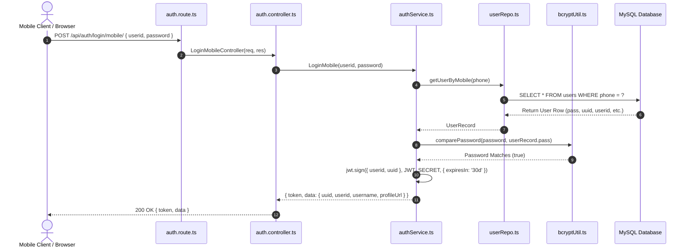
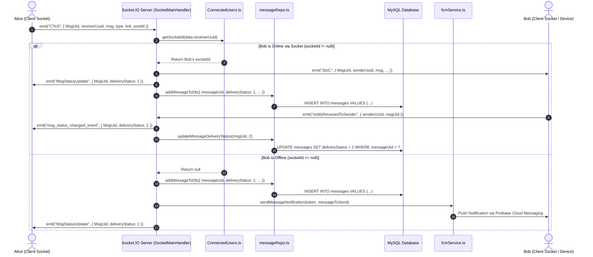
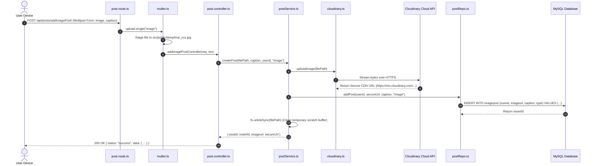
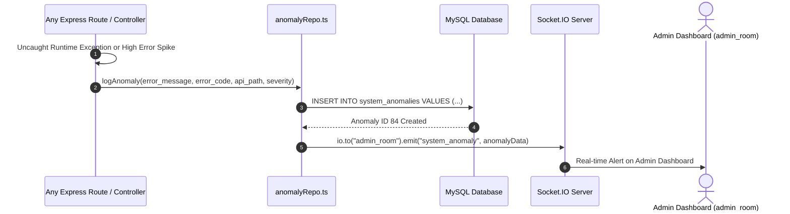
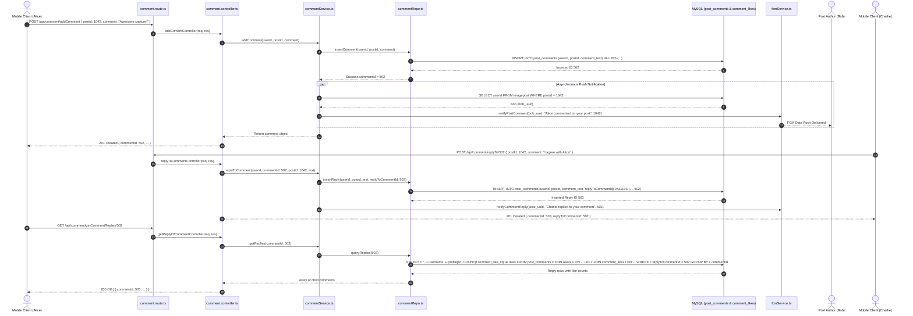
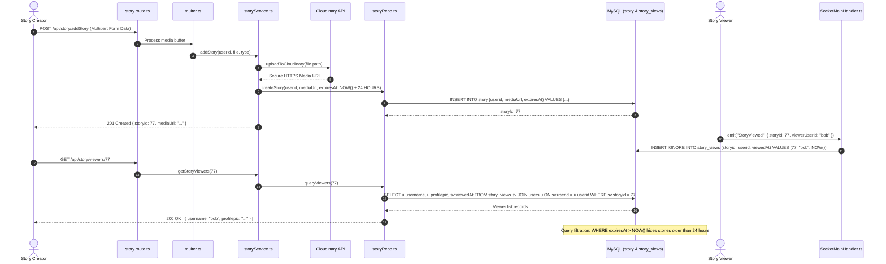
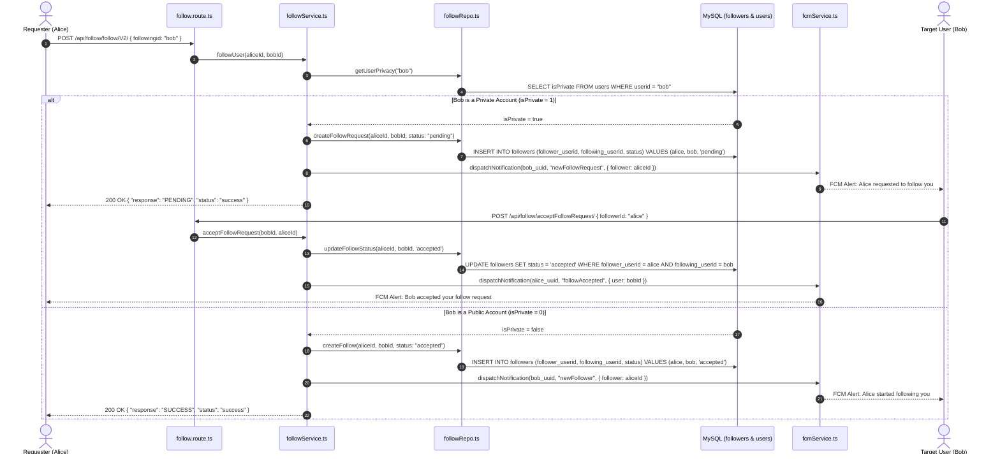

# 01-Architecture — Server Data Flows & Sequence Diagrams

This document details the core data pipelines and request lifecycles executed by the Threadly TypeScript Server using GitHub-flavored Mermaid sequence diagrams.

---

## 1. User Authentication & JWT Issuance Pipeline

This sequence diagrams user login across credentials extraction, repository lookup, Bcrypt password comparison, and JWT token issuance.

---

## 2. Real-Time Message Brokerage & FCM Push Fallback

This sequence diagrams how `SocketMainHandler.ts` routes real-time chat messages between peers, records delivery status in MySQL, and delegates to Firebase Cloud Messaging when the recipient is offline.

---

## 3. Media Ingestion & Cloudinary Upload Pipeline

This sequence diagrams image/video upload handling from multipart parsing to Cloudinary storage and database persistence.

---

## 4. Administrative Moderation & Anomaly Alerting

This sequence diagrams how runtime exceptions are captured, persisted into `system_anomalies`, and pushed live to connected admin dashboards.

---

## 6. Comments & Nested Replies Data Flow

This sequence diagrams how the backend handles top-level comments, parent-child thread lookups (`replyToCommentId`), comment likes, and asynchronous push notification dispatch via FCM.

---

## 7. Story Publishing, Expiration & Realtime View Beacon Flow

This sequence diagrams ephemeral 24-hour stories: media upload to Cloudinary, database persistence with auto-expiration TTL, live Socket.IO view receipts, and viewer audits.

---

## 8. Social Graph & Private Profile Approval Pipeline

This sequence diagrams relationship state transitions: following public accounts vs. requesting to follow private accounts, follow request cancellation, approval, rejection, and FCM status notifications.

