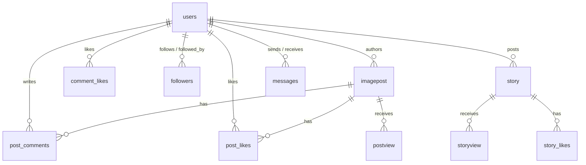

# 02-Contracts & APIs — Persistence, Schemas & Storage

This document details the relational MySQL schemas, indexing strategies, Redis caching keys, and Cloudinary media configurations used by the Threadly TypeScript Server.

---

## 1. MySQL Relational Schema Overview

The MySQL database contains 15 primary tables modeled directly in `schema.txt`:



---

## 2. Table DDL & Schema Definitions

### A. Table: `users`
```sql
CREATE TABLE users (
  userid VARCHAR(250) NOT NULL PRIMARY KEY,
  username VARCHAR(250) NOT NULL,
  email VARCHAR(250) DEFAULT NULL,
  phone VARCHAR(250) DEFAULT NULL,
  pass TEXT NOT NULL,
  bio VARCHAR(255) NOT NULL DEFAULT 'I use threadly daily',
  profilepic TEXT DEFAULT NULL,
  dob DATE NOT NULL,
  createdAt DATETIME NOT NULL DEFAULT CURRENT_TIMESTAMP,
  uuid VARCHAR(36) NOT NULL,
  fcmToken TEXT NULL,
  isPrivate BOOLEAN DEFAULT FALSE,
  blocked BOOLEAN DEFAULT FALSE,
  isDeleted BOOLEAN DEFAULT FALSE,
  banDuration ENUM('24hr', 'permanent', 'none') DEFAULT 'none',
  banReason TEXT NULL,
  profileVersion INT NOT NULL DEFAULT 1,
  modifiedAt DATETIME NOT NULL DEFAULT CURRENT_TIMESTAMP,
  sessionId TEXT NULL,
  UNIQUE KEY email (email),
  UNIQUE KEY phone (phone),
  UNIQUE KEY uuid (uuid)
);
```

### B. Table: `imagepost`
```sql
CREATE TABLE imagepost (
  postid INT NOT NULL AUTO_INCREMENT PRIMARY KEY,
  userid VARCHAR(250) NOT NULL,
  imageurl TEXT NOT NULL,
  caption VARCHAR(255),
  created_at DATETIME DEFAULT CURRENT_TIMESTAMP,
  type TEXT NOT NULL,
  isDeleted BOOLEAN DEFAULT FALSE,
  FOREIGN KEY (userid) REFERENCES users(userid) ON DELETE CASCADE ON UPDATE CASCADE
);
```

### C. Table: `messages`
```sql
CREATE TABLE messages (
  messageId BIGINT NOT NULL AUTO_INCREMENT PRIMARY KEY,
  messageUid CHAR(36) NOT NULL,
  replyToMessageId CHAR(36) NULL,
  senderUUId CHAR(36) NOT NULL,
  recieverUUId CHAR(36) NOT NULL,
  type ENUM('text','image','video','audio','file','post','story') DEFAULT 'text',
  message TEXT,
  postId INT DEFAULT NULL,
  postLink TEXT,
  creationTime TIMESTAMP DEFAULT CURRENT_TIMESTAMP,
  deliveryStatus TINYINT DEFAULT 0,
  isDeletedByReceiver BOOLEAN DEFAULT FALSE,
  isDeletedBySender BOOLEAN DEFAULT FALSE,
  isDeletedBoth BOOLEAN DEFAULT FALSE,
  FOREIGN KEY (senderUUId) REFERENCES users(uuid) ON DELETE CASCADE ON UPDATE CASCADE,
  FOREIGN KEY (recieverUUId) REFERENCES users(uuid) ON DELETE CASCADE ON UPDATE CASCADE
);
```

### D. Table: `followers`
```sql
CREATE TABLE followers (
  followid INT NOT NULL AUTO_INCREMENT PRIMARY KEY,
  followerid VARCHAR(250) NOT NULL,
  followingid VARCHAR(250) NOT NULL,
  isApproved BOOLEAN DEFAULT FALSE,
  createdAt DATETIME DEFAULT CURRENT_TIMESTAMP,
  FOREIGN KEY (followerid) REFERENCES users(userid) ON DELETE CASCADE ON UPDATE CASCADE,
  FOREIGN KEY (followingid) REFERENCES users(userid) ON DELETE CASCADE ON UPDATE CASCADE
);
```

### E. Other Relational Tables
- **`post_comments`**: Stores threaded comments and replies (`replyToCommentId`).
- **`post_likes` & `comment_likes`**: Tracks user like interactions.
- **`story` & `story_likes`**: Stores 24h stories and their likes.
- **`postview` & `storyview`**: Tracks impression metrics with deduplicated `(userid, uuid, postid)`.
- **`post_reports`**: Moderation table storing reported posts and review statuses (`pending`, `reviewed`, `dismissed`).
- **`system_anomalies`**: Runtime anomaly ledger capturing message, code, path, and severity (`low`, `medium`, `high`, `critical`).

---

## 3. Database Indexing Strategy

To maintain sub-20ms query times at scale, the database defines specialized indexes:
```sql
-- Fast full-text / prefix search on post captions
CREATE INDEX idx_captions_userid ON imagepost(caption);

-- Unique index ensuring O(1) user profile lookups
CREATE UNIQUE INDEX idx_users_userid ON users(userid);

-- Unique constraint ensuring O(1) UUID resolving
CREATE UNIQUE INDEX idx_users_uuid ON users(uuid);
```

---

## 4. Redis Caching & In-Memory Storage

Managed via `ioredis` in `src/redis/redis.ts` and `src/redis/operation.ts`:
- **Connection**: Connects via `process.env.REDIS_URL`.
- **Primary Use Cases**:
  1. **OTP Verification Temporary Tokens**: Key format `otp:<phone_or_email>` with a 300-second (5 minute) TTL.
  2. **Rate Limiting & Anti-Abuse**: Tracks failed authentication attempts per IP.
  3. **Real-time Metrics Caching**: Caches aggregated follower counts to reduce heavy MySQL `COUNT(*)` queries on popular creator profiles.

---

## 5. Cloudinary Media Asset Pipeline

Managed in `src/services/cloudinary.ts`:
- **Credentials**: `CLOUDINARY_CLOUD_NAME`, `CLOUDINARY_API_KEY`, `CLOUDINARY_API_SECRET`.
- **Resource Types**:
  - `image`: Auto-converted to WebP format, stripped of EXIF metadata.
  - `video`: Auto-transcoded to MP4 (H.264 / AAC) with progressive download optimization for Android ExoPlayer streaming.
