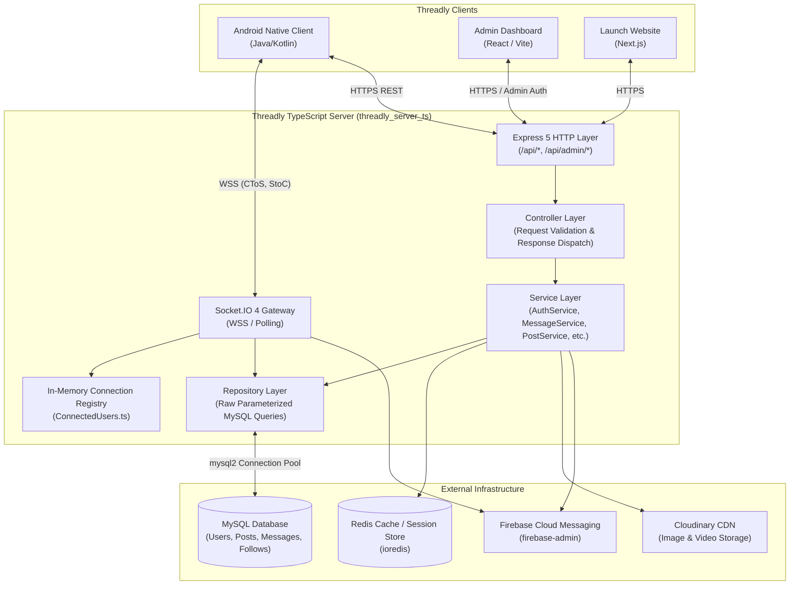

# Threadly TypeScript Backend — Architecture & Engineering Documentation

Welcome to the **Threadly TypeScript Server (`threadly_server_ts`)** engineering documentation hub. This repository houses the core backend engine powering the Threadly platform. It provides high-throughput REST APIs, bidirectional Socket.IO real-time event routing, relational persistence on MySQL, Redis session/cache acceleration, Cloudinary media processing, and Firebase Cloud Messaging (FCM) push dispatchers.

This documentation suite serves as the **contract-bound source of truth** for human lead architects and AI pair programmers. Every specification, schema, endpoint signature, and lifecycle flow here is grounded directly in the production TypeScript codebase.

---

## 🏛 Documentation Navigation Hub

```
docs/
├── README.md                              # This navigation hub & architecture index
├── CODEBASE_INDEX.md                      # Exhaustive inventory of all 119 source modules
├── 01-architecture/
│   ├── overview.md                       # Product goals, system topology, constraints & tech stack
│   ├── component-architecture.md         # Express route/controller/service/repo layers & state
│   ├── process-isolation.md              # Container isolation, auth guards, rate-limiting & security
│   └── data-flows.md                     # Mermaid sequence diagrams for all core server journeys
├── 02-contracts-and-apis/
│   ├── api-contracts.md                  # Comprehensive REST & Admin API specifications (inputs/outputs)
│   ├── realtime-protocol.md              # Socket.IO event framing, room multiplexing & FCM payloads
│   └── persistence-and-storage.md        # MySQL relational DDL, indexing, Redis schemas & Cloudinary
├── 03-developer-playbook/
│   ├── local-setup.md                    # Environment variables, Docker, MySQL, Redis & local running
│   ├── debugging-and-inspection.md       # Pino logs, breakpoint targets, Postman collection & test suites
│   └── build-and-packaging.md            # TypeScript build (tsc), Docker containerization & Render deployment
├── 04-change-playbooks/
│   ├── how-to-add-a-feature.md           # Step-by-step recipes (new route, controller, service, repo)
│   └── troubleshooting.md                # MySQL pool exhaustion, Socket.IO memory leaks & FCM error codes
└── 05-adrs/
    ├── ADR-001-core-engine-choice.md     # Why Express + Socket.IO + MySQL + Redis was chosen
    └── ADR-002-state-and-framework.md    # Why Layered Service-Repository Pattern in TypeScript
```

---

## 🧭 Architecture Index & Quick Reference

| Topic / Requirement | Target Document | Summary Description |
| :--- | :--- | :--- |
| **System Overview & Topology** | [01-architecture/overview.md](01-architecture/overview.md) | High-level system structure, multi-client topology, hosting constraints. |
| **Component Architecture** | [01-architecture/component-architecture.md](01-architecture/component-architecture.md) | Layered architecture: Routes -> Controllers -> Services -> Repositories. |
| **Security & Process Boundaries** | [01-architecture/process-isolation.md](01-architecture/process-isolation.md) | JWT auth guards, admin roles, bcrypt hashing, error sanitization. |
| **Sequence Diagrams & Flows** | [01-architecture/data-flows.md](01-architecture/data-flows.md) | Mermaid sequence diagrams for Auth, Chat, Media Posts, Reels, & Admin moderation. |
| **REST & Admin API Contracts** | [02-contracts-and-apis/api-contracts.md](02-contracts-and-apis/api-contracts.md) | Endpoint signatures across Auth, Posts, Comments, Follow, Profile, Messages, Admin. |
| **Realtime Protocol & Push** | [02-contracts-and-apis/realtime-protocol.md](02-contracts-and-apis/realtime-protocol.md) | Socket.IO framing (`CToS`, `StoC`, `notifyReceivedToSender`), FCM push broadcasts. |
| **Persistence & MySQL Schemas** | [02-contracts-and-apis/persistence-and-storage.md](02-contracts-and-apis/persistence-and-storage.md) | MySQL relational DDL, foreign keys, indexes, Redis key structures, Cloudinary. |
| **Local Setup & Workflows** | [03-developer-playbook/local-setup.md](03-developer-playbook/local-setup.md) | Node.js 20+, Docker Compose, `.env` variables, npm scripts (`dev`, `build`, `test`). |
| **Debugging & Diagnostics** | [03-developer-playbook/debugging-and-inspection.md](03-developer-playbook/debugging-and-inspection.md) | Pino structured logging, Node native test runner (`node --test`), Postman. |
| **Build & Deployment** | [03-developer-playbook/build-and-packaging.md](03-developer-playbook/build-and-packaging.md) | `tsc` compilation, Dockerfile multi-stage builds, Render cloud orchestration. |
| **Feature Modification Recipes** | [04-change-playbooks/how-to-add-a-feature.md](04-change-playbooks/how-to-add-a-feature.md) | Concrete recipes for adding a new route, controller, service method, and SQL query. |
| **Incident Troubleshooting** | [04-change-playbooks/troubleshooting.md](04-change-playbooks/troubleshooting.md) | MySQL connection drops, Redis timeout, unhandled socket exceptions, FCM quota. |
| **Core Engine ADR** | [05-adrs/ADR-001-core-engine-choice.md](05-adrs/ADR-001-core-engine-choice.md) | Architecture rationale for Express, Socket.IO, MySQL2, and Redis. |
| **Layering & Framework ADR** | [05-adrs/ADR-002-state-and-framework.md](05-adrs/ADR-002-state-and-framework.md) | Architecture rationale for Service-Repository pattern over ORMs. |
| **Complete Codebase Inventory** | [CODEBASE_INDEX.md](CODEBASE_INDEX.md) | Exhaustive tabular index of every source module, class, and export. |

---

## 🌐 High-Level System Topology



---

## ⚡ Key Engineering Principles

1. **Strict Layered Separation**: HTTP routers (`routes/`) only bind middleware and delegate to controllers (`controller/`). Controllers validate inputs and delegate to services (`services/`). Services implement domain business logic and call repositories (`repo/`). Repositories exclusively interact with MySQL or Redis.
2. **Parameterized SQL Queries**: No dynamic string concatenation for SQL statements. Every query executed via `fetchDb` or `connection.execute` uses bound `?` parameters to prevent SQL injection vulnerabilities.
3. **Idempotent Real-Time Messaging**: The Socket.IO gateway writes messages to MySQL with client-generated `messageUid`s before emitting delivery updates. If the recipient is disconnected, the server automatically delegates to Firebase Cloud Messaging (`fcmService.sendMessageNotification()`).
4. **Structured Pino Logging**: Avoid `console.log` in production code. Use `logger.info()`, `logger.warn()`, and `logger.error(formErrorBody(...))` to produce machine-parsable JSON logs.
